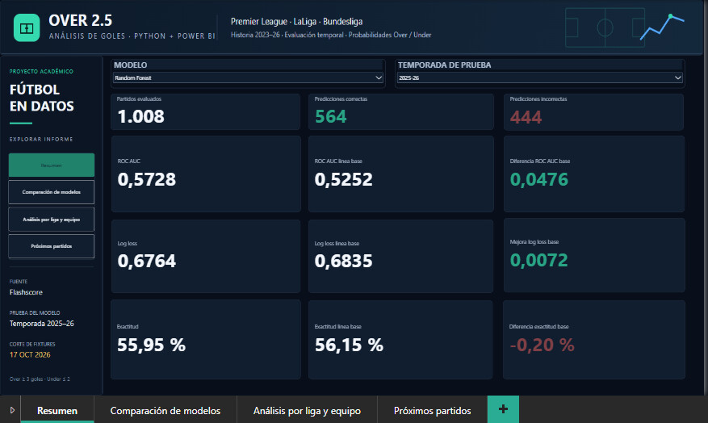
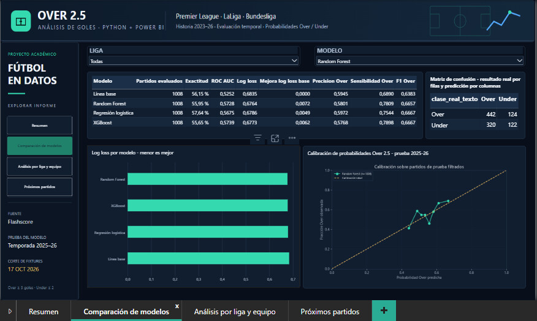
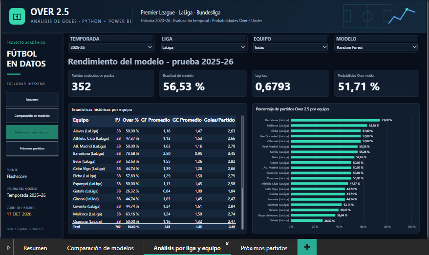
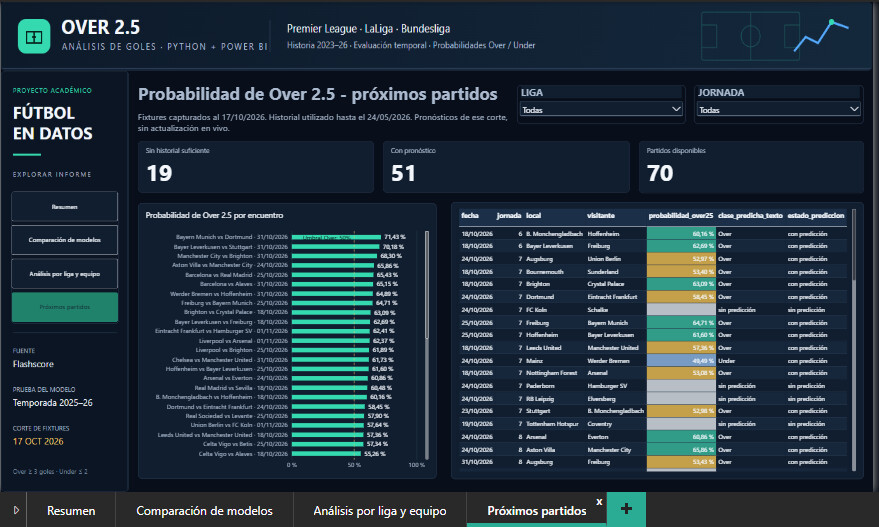

# ¿Aporta señal el historial reciente? Predicción de Over/Under 2,5 goles

> Un pipeline completo (datos, variables sin fuga de información, comparación de modelos con validación temporal y un informe de cuatro páginas en Power BI) con una lección incluida: **evaluar bien importa más que presumir un porcentaje de aciertos**.

## En una mirada

| | |
|---|---|
| **Pregunta** | ¿Las estadísticas de los últimos partidos de cada equipo ayudan a anticipar si habrá tres o más goles? |
| **Alcance** | Premier League, LaLiga y Bundesliga · 3.198 partidos de tres temporadas |
| **Método** | Variables con ventanas de 5 y 10 partidos, validación temporal, cuatro modelos, pérdida logarítmica y calibración |
| **Resultado** | Mejora modesta y honesta sobre la línea base: AUC 0,5728 frente a 0,5252 |
| **Herramientas** | Python, pandas, scikit-learn, XGBoost, Power BI y DAX |

**Over** = tres o más goles. **Under** = dos o menos.



## Por qué existe este proyecto

El mercado de goles totales es un laboratorio limpio para practicar evaluación honesta de modelos: la etiqueta es binaria, el resultado se conoce pronto y es muy fácil engañarse con una validación mal hecha. Quise construir el flujo completo cuidando lo que más se descuida: usar solo información anterior a cada partido, separar entrenamiento y prueba por tiempo, y medir calibración y pérdida logarítmica, no solo aciertos.

## Metodología: lo que hace confiable el resultado

1. **Sin fuga de información.** Cada variable se calcula solo con partidos *estrictamente anteriores* al que se predice, y todos los partidos del mismo día se excluyen del historial. El historial se arrastra entre temporadas, con un mínimo de 10 partidos generales y 5 en la sede.
2. **Cobertura verificada.** Se exigió cobertura completa de tiros, tiros al arco, posesión y córners en las nueve combinaciones de liga y temporada, y se excluyeron 441 partidos sin historial suficiente (quedan 2.757).
3. **Partición por tiempo.** Entrenamiento con 1.749 partidos de 2023-24 y 2024-25; prueba con 1.008 de 2025-26. Nada del futuro entra al entrenamiento.
4. **Selección dentro del entrenamiento.** Cuatro cortes temporales internos sobre fechas completas, elección por pérdida logarítmica, regularización y semilla fija (42).
5. **Comparación justa.** Línea base por liga, regresión logística, Random Forest y XGBoost, evaluados con las mismas métricas.
6. **Auditoría independiente.** Un script aparte recalcula las medias previas y las fechas de todas las filas, comprueba el hash del dataset aprobado y reproduce las métricas del modelo guardado.
7. **Los datos de entrada se tratan como evidencia.** Cada exportación a Power BI valida claves, grano, conteos y matrices de confusión, y reabre los CSV para comprobarlos.

## Resultados

| Modelo | Exactitud | AUC | Pérdida logarítmica |
|---|---:|---:|---:|
| Línea base por liga | 56,15 % | 0,5252 | 0,6835 |
| **Random Forest (elegido por validación)** | 55,95 % | 0,5728 | **0,6764** |
| Regresión logística | **57,64 %** | 0,5675 | 0,6786 |
| XGBoost | 55,65 % | **0,5739** | 0,6773 |

El modelo se eligió por validación temporal **dentro del entrenamiento**, no mirando la prueba. En la prueba, XGBoost tiene el AUC más alto y la regresión logística la mayor exactitud, pero las diferencias son pequeñas y ningún modelo supera con claridad a los demás. Evaluar así evita escoger el "ganador" después de ver el examen.

**Lectura honesta:** el modelo elegido ordena mejor los partidos y mejora la probabilidad estimada, pero no acierta más que la línea base con un umbral fijo de 0,5. En un problema donde el azar pesa tanto, eso es lo esperable, y saber decirlo es parte del método. Todo está en `resultados/metricas_modelos.csv` (por liga y modelo) y las figuras en `graficas/`.

## El informe en Power BI

📄 [Abrir el informe completo en PDF](informe/informe_power_bi.pdf)

Cuatro páginas con navegación, segmentadores y tema oscuro propio. Guía de construcción en `powerbi/guia_powerbi.md`, medidas en `powerbi/medidas.dax` y diseño en `powerbi/diseno/`.

**1. Resumen:** indicadores del modelo elegido frente a la línea base en la temporada de prueba (1.008 partidos evaluados, 564 predicciones correctas).


**2. Comparación de modelos:** métricas de los cuatro modelos, matriz de confusión, pérdida logarítmica y curva de calibración, filtrables por liga.


**3. Análisis por liga y equipo:** rendimiento del modelo por liga y equipo, y porcentaje de partidos Over por equipo.


**4. Próximos partidos:** probabilidad de Over 2,5 de 51 de los 70 partidos de las próximas jornadas. Los 19 restantes quedan sin pronóstico por historial insuficiente.


## Datos y extracción

- **Los datos no se publican.** Provienen de Flashscore y su redistribución no está permitida, así que la carpeta `data/` y el archivo `.pbix` (que los incluye) quedan fuera del repositorio.
- **El código de extracción tampoco se publica.** Se omite a propósito. Quien quiera reproducir el análisis debe obtener los datos de forma legítima y respetar los términos de la fuente.
- El resto del código (limpieza, variables, modelado, gráficas, verificación y exportación) se publica para que el método sea revisable.

## Estructura

```text
src/          Limpieza, variables, modelo, gráficas, verificación y exportación (comentado en español)
graficas/     Ocho figuras: calibración, ROC, matrices de confusión, importancia de variables, Over por liga y equipo
informe/      Informe de Power BI en PDF, reporte consolidado, borrador académico y capturas
powerbi/      Guía, medidas DAX, visual en Python y diseño
resultados/   Métricas por modelo e importancia de variables
```

## Límites

- La mejora sobre la línea base es pequeña y no garantiza utilidad práctica.
- Solo tres ligas y tres temporadas.
- Los partidos de 2026-27 se usaron únicamente como fixtures, sin resultados, y el modelo no se reajustó con ellos.

## Autor

**Mauricio Serrano** · Ingeniería Industrial, Universidad del Magdalena · [Portafolio](https://madsh26.github.io) · [LinkedIn](https://www.linkedin.com/in/mauricio-david-serrano-hernandez/)
